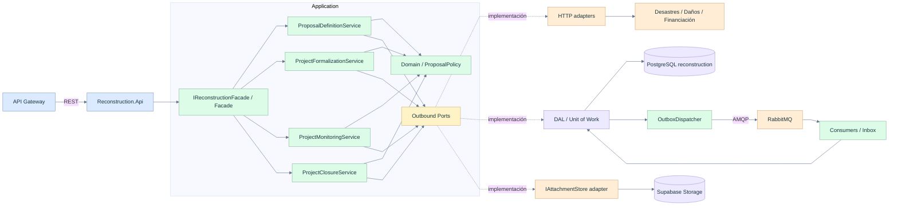
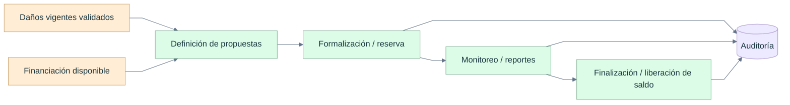
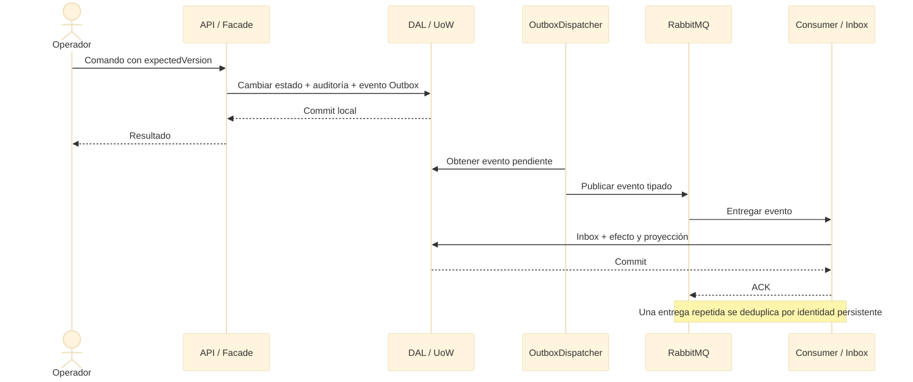

<div align="center">

# RECONECTA

### Reconstruction

**De la emergencia a la reconstrucción**

Servicio de definición, formalización, monitoreo y cierre de proyectos.


**Pontificia Universidad Javeriana**

Arquitectura de Software · 2026

[Plataforma completa](https://github.com/disaster-management-platform/disaster-platform-infrastructure) · [Arquitectura](#arquitectura) · [Demostración](#demostración) · [Instalación](#instalación-y-ejecución)

</div>

---

## Demostración

<div align="center">

[](https://youtu.be/HVCKoTRAxu8)

[Ver demostración funcional de RECONECTA](https://youtu.be/HVCKoTRAxu8)

</div>

## Descripción

`reconstruction-business-layer` administra el ciclo de vida de los proyectos de reconstrucción. Implementa arquitectura hexagonal (Ports and Adapters) con Facade para coordinar casos de uso. Las políticas del dominio se mantienen independientes de HTTP, EF Core, RabbitMQ y almacenamiento de objetos. Consume el contexto de Desastres, evaluaciones vigentes de Daños y disponibilidad de financiación mediante contratos explícitos.

## Contenido

- [Funcionalidades](#funcionalidades)
- [Arquitectura](#arquitectura)
- [Decisiones arquitectónicas](#decisiones-arquitectónicas)
- [Tecnologías y justificación](#tecnologías-y-justificación)
- [Estructura del repositorio](#estructura-del-repositorio)
- [Integración con otros componentes](#integración-con-otros-componentes)
- [Persistencia](#persistencia)
- [Contratos de comunicación](#contratos-de-comunicación)
- [Seguridad](#seguridad)
- [Instalación y ejecución](#instalación-y-ejecución)
- [Pruebas](#pruebas)
- [Alcance y validación](#alcance-y-validación)
- [Repositorios relacionados](#repositorios-relacionados)
- [Autores](#autores)

## Funcionalidades

| Funcionalidad | Descripción |
| --- | --- |
| Definición | Generación de propuestas según daño, zona, tipo de activo y financiación. |
| Formalización | Selección de propuesta, responsables, contratista, cronograma y reserva de presupuesto. |
| Monitoreo | Seguimiento de actividades, reportes, costos, evidencia y cambios justificados. |
| Finalización | Cierre condicionado a actividades completas, reporte consolidado y liberación de saldo. |
| Auditoría | Historial y línea de tiempo recuperable mediante eventos tipados. |
| Adjuntos | Almacenamiento privado e inmutable con verificación SHA-256. |

## Arquitectura

### Vista lógica — arquitectura hexagonal

Las flechas representan dependencias y uso de interfaces. Los adaptadores implementan los puertos, no condicionan las reglas del dominio.




### Responsabilidades de los componentes

| Componente | Responsabilidad |
| --- | --- |
| Reconstruction.Api | Endpoints, composición DI y adaptación de permisos. |
| Reconstruction.Domain | Políticas de propuestas; entidades e invariantes compartidas vía Core. |
| Reconstruction.Application | Casos de uso, Facade, puertos y coordinación de eventos. |
| Reconstruction.Infrastructure | Adaptadores HTTP, resiliencia, objetos y RabbitMQ. |
| DisasterPlatform.DAL | Repositorios, unidad de trabajo, auditoría, Inbox y Outbox. |
| WorkflowProjectionRecovery | Recuperación y reconciliación de proyecciones de seguimiento. |

### Flujo de negocio


La generación de propuestas y proyectos exige Recovery o Reconstruction. Closed permite consultar y terminar proyectos históricos, pero no crear otros. Las propuestas agrupan evaluaciones actuales validadas con daño distinto de None por zona y activo. La gravedad media guía la asignación de recursos; la reserva transaccional evita comprometer más presupuesto que el disponible. El cierre verifica las actividades y conserva el historial ejecutado.

### Procesamiento asíncrono y recuperación


El proceso ASP.NET Core aloja API y workers registrados. RabbitMQ y PostgreSQL se despliegan aparte. Los eventos y la línea de tiempo no sustituyen el estado relacional vigente: no se implementa Event Sourcing como modelo de persistencia del dominio.

## Decisiones arquitectónicas

| Atributo de calidad | Decisión | Mecanismo y compromiso |
| --- | --- | --- |
| Modificabilidad | Hexagonal + Facade | Aísla políticas y adaptadores; introduce interfaces y composición explícitas. |
| Interoperabilidad | Puertos y contratos REST | Permite sustituir proveedores sin compartir sus esquemas. |
| Integridad | Unidad de trabajo y control de versión | Reserva y auditoría atómicas; conflictos explícitos. |
| Resiliencia | Outbox / Inbox | Tolera pérdida de respuesta y entregas duplicadas; consistencia eventual de proyecciones. |
| Disponibilidad | Resiliencia HTTP y Storage compartido | Circuit breaker para Desastres y datos fuera del contenedor; dependencias siguen siendo necesarias. |
| Escalabilidad | Workers y consumidores | Escalamiento selectivo; requiere capacidad PostgreSQL y broker. |

## Tecnologías y justificación

| Tecnología | Justificación para la integración |
| --- | --- |
| .NET 10 / ASP.NET Core | Expone el dominio mediante contratos compatibles con Gateway, Razor y Jakarta EE. |
| EF Core / Npgsql / NuGet | Reutiliza las abstracciones y persistencia compartidas conservando propiedad de reconstruction. |
| RabbitMQ / AMQP | Intercambia eventos tipados y permite consumidores separados del comando interactivo. |
| PostgreSQL | Mantiene consistencia de reservas, proyectos, auditoría y recibos en transacciones locales. |
| Supabase Storage | Permite a réplicas acceder a documentos privados sin afinidad de disco local. |
| HttpClient / REST | Conecta proveedores de contexto, daños y financiación sin contaminar Domain. |
| Docker | Distribuye API y workers como unidad ejecutable del despliegue integrado. |

## Estructura del repositorio

```text
reconstruction-business-layer/
├── Reconstruction.Api/
├── Reconstruction.Domain/
├── Reconstruction.Application/
│   ├── Contracts/
│   ├── Facade/
│   ├── Ports/
│   ├── Services/
│   └── Messaging/
├── Reconstruction.Infrastructure/
│   ├── ExternalAdapters/
│   └── Messaging/
├── Reconstruction.Tests/
├── docs/
├── scripts/
├── server/storage.sql
├── DisasterLocation.sln
├── docker-compose.yml
└── Dockerfile
```

## Integración con otros componentes

| Dependencia | Contrato y responsabilidad |
|---|---|
| Desastres | REST, fase y ámbito del recurso mediante `IDisasterReader`. |
| Evaluación de Daños | Snapshot de evaluaciones vigentes con revisión y presupuesto. |
| Financiación | Adaptador de disponibilidad de fondos; datos simulados en modo demo. |
| RabbitMQ | Eventos tipados y consumidores de Formalización, Monitoreo y Finalización. |
| Supabase Storage | `IAttachmentStore` implementado por `ObjectAttachmentStore`; descarga a través de la API. |
| Gateway / Portal | Operaciones interactivas mediante REST. |

No se utiliza el inventario de Eden como presupuesto financiero. El proveedor real de financiación no debe confundirse con el modo de demostración. Consultar [contratos de integración](docs/integracion.md) y [arquitectura](docs/arquitectura.md).

## Persistencia

El servicio escribe exclusivamente el esquema `reconstruction`. La API referencia Core 4.0.0, DAL 6.0.0 y Security 1.0.0 en el commit consultado; las últimas versiones del repositorio compartido no son automáticamente las consumidas aquí. Las entidades y reservas se persisten mediante EF Core; la unidad de trabajo conserva auditoría y eventos Outbox. Inbox deduplica efectos de consumo. Los adjuntos se almacenan en el bucket privado `reconstruction-attachments`: un objeto inmutable conserva metadatos y bytes; máximo estándar 20 MiB más envelope. La API verifica acceso y SHA-256; no retorna URLs públicas ni prefirmadas. La implementación local de archivos es únicamente una opción de desarrollo, no fallback productivo.

## Contratos de comunicación

| Método | Ruta | Responsabilidad |
| --- | --- | --- |
| GET | `/api/reconstruccion/health` y `/ready` bajo el mismo prefijo | Diagnóstico. |
| GET | `/api/reconstruccion/access-mode` | Modo de acceso. |
| GET | `/api/reconstruccion/financiacion` | Consultar fondos. |
| GET | `/api/reconstruccion/workflow` | Flujo. |
| POST | `/api/reconstruccion/propuestas/generar` | Generar propuestas. |
| GET | `/api/reconstruccion/propuestas` | Consultar propuestas. |
| GET / POST | `/api/reconstruccion/proyectos` | Consultar / crear. |
| GET | `/api/reconstruccion/proyectos/{id}` | Detalle. |
| PUT | `/api/reconstruccion/proyectos/{id}/formalizacion` | Formalizar. |
| POST | `/api/reconstruccion/proyectos/{id}/confirmar-formalizacion` | Confirmar. |
| PUT | `/api/reconstruccion/proyectos/{id}/presupuesto` | Revisión presupuestal. |
| POST | `/api/reconstruccion/proyectos/{id}/contrato-firmado` | Registrar contrato. |
| GET | `/api/reconstruccion/proyectos/{id}/monitoreo` | Monitorear. |
| POST | `/api/reconstruccion/proyectos/{id}/actividades/{activityId}/reportes` | Registrar avance. |
| POST | `/api/reconstruccion/proyectos/{id}/cerrar` | Cierre. |
| GET | `/api/reconstruccion/proyectos/{id}/auditoria` | Auditoría. |
| GET | `/api/reconstruccion/proyectos/{id}/linea-tiempo` | Seguimiento. |
| GET | `/api/reconstruccion/proyectos/{id}/reporte-final` | Reporte final. |
| POST | `/api/reconstruccion/proyectos/{id}/adjuntos` | Subir archivo. |
| GET | `/api/reconstruccion/proyectos/{id}/adjuntos/{attachmentId}` | Descargar. |
Las operaciones versionadas usan `expectedVersion`; los reportes conservan identidad para evitar duplicar costos. El contrato financiero real depende del proveedor autorizado y no se inventan transferencias.

## Seguridad

JWT con audiencia `reconstruction-api`, roles `reconstruction.read/write` y ámbito de desastre. Para administradores de Desastres se consulta el ámbito autorizado al servicio propietario mediante JWT del usuario con las audiencias necesarias; no se concede acceso global. Los adaptadores de servicio usan Client Credentials de alcance mínimo, cachean tokens y no repiten mutaciones automáticamente ante 401. Storage utiliza identidad técnica separada y acceso privado; nunca se usa una clave administradora como credencial de ejecución.

## Instalación y ejecución

Para ejecutar la plataforma completa, consultar [Infrastructure](https://github.com/disaster-management-platform/disaster-platform-infrastructure).

```bash
git clone https://github.com/disaster-management-platform/reconstruction-business-layer.git
cd reconstruction-business-layer
```
```bash
dotnet restore
dotnet build --no-restore
docker build --secret id=nuget_credentials,src="$NUGET_CREDENTIALS_FILE" -t reconstruction-business-layer:local .
```

Requiere .NET SDK 10 y acceso de lectura a GitHub Packages. El archivo protegido de BuildKit contiene `Username=<account>;Password=<token>` para GitHubPackages. No incorporar el token en la imagen. El contenedor escucha en 8080 y se ejecuta sin privilegios de root. Configurar credenciales y CA de confianza externamente.

Configurar `ConnectionStrings__Disasters` con la conexión propia de Reconstrucción (nombre histórico de la variable), `Security__Authority`, `Security__Audience`, `ExternalApis__Disasters`, configuración de Daños/financiación y `ExternalApis__Disasters__OAuth__TokenEndpoint`, `ClientId`, `ClientSecret` bajo el mismo prefijo; equivalentes para DamageAssessments. Habilitar mensajería con `Messaging__Enabled=true` y sus parámetros del broker. Configurar `Attachments__Storage__BaseUrl`, `Bucket`, `PublishableKey`, `Email`, `Password` bajo el mismo prefijo. Las migraciones se aplican de forma explícita con el inicializador compartido y credenciales administrativas separadas; no al arrancar.

### Desarrollo aislado (datos simulados)

```bash
export RECONSTRUCTION_CONNECTION_STRING="$(cat "$RECONSTRUCTION_CONNECTION_FILE")"
export ExternalApis__Disasters=http://localhost:5156/
dotnet build DisasterLocation.sln
dotnet build ../disaster-api-gateway/DisasterLocation.Gateway.sln
docker compose up -d rabbitmq
python3 scripts/run_local.py --demo --messaging
```

El modo demo no representa una integración real con la financiación. Desastres debe estar iniciado aparte. Para la ejecución integrada utilizar Infrastructure. Comprobar `/api/reconstruccion/health` y `/api/reconstruccion/ready`.

## Pruebas

```bash
export TEST_POSTGRES_DSN="host=${PGSOCKET:?Configura socket PostgreSQL local} port=5432 dbname=postgres user=$(id -un)"
export TEST_POSTGRES_CONNECTION="Host=$PGSOCKET;Port=5432;Database=postgres;Username=$(id -un)"
dotnet test
```

Se requiere PostgreSQL aislado por socket Unix, permisos para bases temporales y `psycopg2` para los scripts Python. Nunca utilizar el proyecto Supabase de entrega.

```bash
python3 scripts/platform_e2e.py
python3 scripts/messaging_e2e.py
python3 scripts/monitoring_e2e.py
python3 scripts/finalization_e2e.py
python3 -m unittest discover -s scripts -p 'test_*.py'
```

La suite de mensajería requiere RabbitMQ local y crea un vhost propio. Las pruebas cubren definición, reserva, formalización, avances, cierre, permisos, fallas HTTP, idempotencia y persistencia. `dotnet test Reconstruction.Tests --filter FullyQualifiedName~ClientCredentialsTests` verifica credenciales técnicas. Utilizar datos sintéticos y Storage aislado para pruebas de archivos.

## Alcance y validación

La arquitectura habilita integración con Daños y financiación, pero el modo demo puede utilizar datos externos simulados. No se certifica transferencia de dinero ni failover de infraestructura. No se ejecutaron nuevamente las pruebas.

Referencia del código consultado: [`9675660`](https://github.com/disaster-management-platform/reconstruction-business-layer/tree/96756603e66358e762257deb8b522c859d9be6ec). Los resultados cuantitativos de los atributos de calidad requieren experimentos sobre el despliegue integrado.

## Repositorios relacionados

| Repositorio | Responsabilidad |
| --- | --- |
| [Infrastructure](https://github.com/disaster-management-platform/disaster-platform-infrastructure) | Despliegue integral |
| [Presentation](https://github.com/disaster-management-platform/disaster-platform-presentation) | Portal Razor MVC |
| [Mobile Client](https://github.com/disaster-management-platform/disaster-mobile-client) | Android Offline First |
| [API Gateway](https://github.com/disaster-management-platform/disaster-api-gateway) | Enrutamiento YARP |
| [Disaster Management](https://github.com/disaster-management-platform/disaster-backend-offline) | Gestión de desastres |
| [Damage Assessment](https://github.com/disaster-management-platform/disaster-damage-assessmet-service) | Evaluación de daños |
| [Integration Service](https://github.com/disaster-management-platform/disaster-integration-service) | Interoperabilidad y ACL |
| [Sahana Eden](https://github.com/disaster-management-platform/sahana-eden) | Gestión humanitaria nativa |
| [Platform DAL](https://github.com/disaster-management-platform/disaster-platform-dal) | Bibliotecas de persistencia y contratos |

## Autores

<div align="center">

**Pontificia Universidad Javeriana**

Facultad de Ingeniería — Departamento de Ingeniería de Sistemas

Arquitectura de Software · 2026-30

| Integrantes |
|:---:|
| Juan Felipe Rodríguez |
| Viviana Gómez León |
| Valeria Catalina Caycedo Ramírez |
| Sofía Guerra Jiménez |

**Docente:** César Julio Bustacara Medina

---

### RECONECTA

*De la emergencia a la reconstrucción.*

</div>