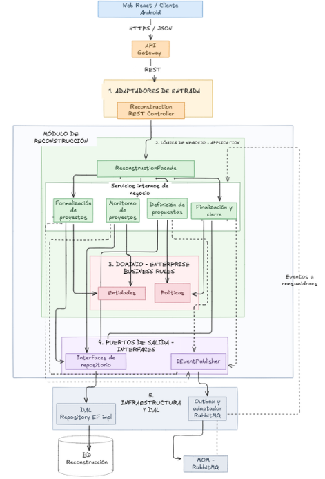

# Reconstrucción

Implementación .NET 10 con dominio, casos de uso, puertos, adaptadores HTTP, EF Core/SQLite, gateway YARP y RabbitMQ. Incluye el backend de desastres compatible con Android. Los originales recibidos permanecen intactos.

## Ejecutar

```bash
dotnet build DisasterLocation.sln
python3 scripts/run_local.py --demo
```

Interfaz: http://localhost:5080. La demostración se identifica en pantalla: utiliza una identidad fija y datos externos simulados. `--messaging` habilita el broker configurado, que debe estar disponible. Para iniciar RabbitMQ local: `docker compose up -d rabbitmq`.

Sin `--demo`, configure identidad y los módulos externos mediante variables de entorno; no se habilitan permisos ni datos ficticios automáticamente. Salud: `/api/reconstruccion/health`; configuración y conexión a BD: `/api/reconstruccion/ready`. Readiness no sustituye la comprobación operativa de los servicios externos.

## Negocio

- Agrupación por zona y tipo de activo. Las categorías de daño son `None`, `Minor`, `Moderate`, `Severe`, `Destroyed`; no representan el nivel de emergencia.
- Pesos relativos: 10, 20, 30 y 40. Peso de propuesta = promedio de los pesos de sus evaluaciones. Presupuesto propuesto = saldo recomendable × peso / suma de pesos. Se redondea por mayores residuos, conservando cada centavo. Dos propuestas con el mismo peso comparten por igual, independientemente del número de evaluaciones que contienen.
- Se restan compromisos financieros y las estimaciones de borradores elegidos para mantener estable el resto de recomendaciones. Estas últimas son recomendaciones, no reservas financieras.
- Solo evaluaciones validadas, con daño y revisión vigente. Un activo ya vinculado a un proyecto genera una revisión si cambia, no otro proyecto automático.
- El desastre debe estar en `Recovery` o `Closed`. Sus fases avanzan `Registered → Response → Recovery → Closed`, con versión y auditoría.
- La formalización exige presupuesto, fuente de donaciones identificada, responsable, contratista y actividades. La reserva monetaria es transaccional y tiene concurrencia por desastre.
- Confirmar formalización inicia monitoreo. Registrar contrato firmado es opcional. Después se modifica presupuesto mediante una revisión motivada, incluyendo redistribución de actividades, sin borrar reportes.
- Los costos de reportes son incrementales, con dos decimales. Se exige revisar y ampliar el presupuesto de la actividad antes de registrar un costo que lo exceda.
- Cada solicitud de reporte lleva un UUID `requestId`, conservado durante reintentos. Repetirlo con el mismo contenido no duplica costos; cambiar contenido produce 409.
- Todos los reportes requieren evidencia y documentación. Los adjuntos se almacenan fuera de wwwroot, vinculados al proyecto, con tipo comprobado y hash SHA-256. Se aceptan PDF, PNG y JPEG, hasta 20 MB. Las referencias libres solo se permiten con datos de demostración.
- Cerrar exige actividades terminadas y reportes finales completos. El consolidado conserva todos los reportes. Se libera el saldo no ejecutado; el costo ejecutado permanece comprometido.
- La auditoría conserva datos del evento y capturas anterior/posterior del proyecto. Los cambios previos a esta versión que no fueron auditados no pueden reconstruirse retroactivamente.

## Integración

Consulte [contratos](docs/integracion.md) y [arquitectura](docs/arquitectura.md). Evaluaciones, donaciones e identidad aún no existen en los repositorios compartidos: sus adaptadores son reales, pero la interoperabilidad se valida con servicios HTTP de prueba.

Android utiliza `BuildConfig.API_BASE_URL`, por defecto `http://10.0.2.2:5080/api/`. Puede configurarse con `-PAPI_BASE_URL=http://IP_DEL_SERVIDOR:5080/api/`. El backend conserva el radio enviado por Android. El registro preliminar de desastres mantiene el acceso anónimo del contrato anterior; los comandos de reconstrucción requieren permisos.

## Seguridad

Variables: `Security__Authority` (emisor OIDC por HTTPS), `Security__Audience`. JWT valida firma, emisor, destinatario y vigencia. Claims requeridos: `sub`, `organization_id`, `role` y un `disaster_id` por desastre autorizado. Roles `reconstruction.read` y `reconstruction.write`. El emisor debe verificar la pertenencia a la organización antes de conceder los desastres. Nunca se confía en X-Actor.

El acceso web actual permite suministrar el token emitido por la organización, en `/access.html`; no implementa un proveedor de identidad ni su pantalla de autenticación. El token se conserva únicamente en la sesión del navegador. La integración de inicio de sesión OIDC depende del proveedor elegido.

`Security__LocalDemo=true` solo funciona en Development y muestra una advertencia visible. No hay contraseñas, claves JWT ni credenciales financieras incorporadas. RabbitMQ usa credenciales locales de desarrollo; despliegues deben reemplazarlas por configuración segura.

Los adjuntos locales son un adaptador de almacenamiento: antes de un despliegue distribuido se debe usar almacenamiento compartido y definir retención, copias de seguridad y análisis antivirus. El hash detecta alteraciones; no certifica la veracidad de un documento.

## Validación

```bash
dotnet test DisasterLocation.sln
python3 scripts/platform_e2e.py
python3 scripts/messaging_e2e.py
python3 scripts/smoke_test.py
python3 scripts/monitoring_e2e.py
python3 scripts/finalization_e2e.py
python3 -m unittest discover -s scripts -p 'test_*.py'
```

Las pruebas usan bases y puertos temporales; mensajería utiliza su propio vhost y no detiene el broker compartido. Compilar antes de ejecutar los scripts. `reconstruction_e2e.py` requiere una demostración local ya iniciada.

Las migraciones conservan datos y mantienen historiales separados por contexto. La migración de agrupación conserva propuestas antiguas duplicadas como obsoletas para reconciliarlas. Los mensajes históricos admiten las antiguas categorías de daño solo en lectura. El importador `consolidate_databases.py` se limita al esquema inicial de dos bases separadas y rechaza esquemas posteriores para evitar pérdidas: no es un importador universal.

SQLite compartida y workers dentro de la API son decisiones de desarrollo. Esta entrega no acredita alta disponibilidad ni 10.000 usuarios concurrentes. No se publicaron repositorios ni servicios.
