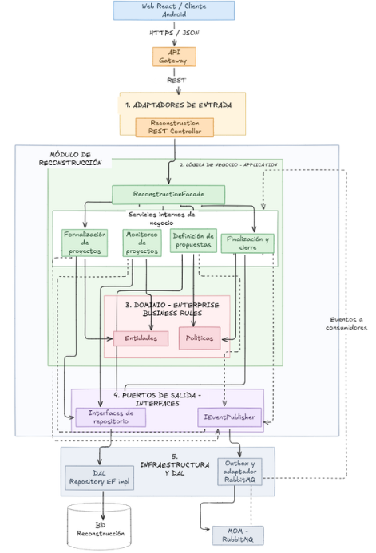

# Arquitectura

Gateway YARP → API → IReconstructionFacade → casos de uso → entidades y políticas.

- Domain: política de reparto; entidades e invariantes mediante DisasterPlatform.Core. No referencia EF, HTTP o RabbitMQ.
- Application: comandos, consultas, orquestación y puertos externos; contratos de persistencia y eventos tipados mediante DisasterPlatform.Core.
- DisasterPlatform.DAL (NuGet): EF Core, conversiones JSON de colecciones, migraciones, repositorios, unidad de trabajo, auditoría, Inbox y Outbox.
- Infrastructure: HTTP de desastres/daños/donaciones, almacenamiento de adjuntos y RabbitMQ.
- DisasterPlatform.Security (NuGet): autenticación JWT y adaptación de claims a permisos por desastre.
- API: contrato HTTP y composición; Gateway: proxy y presentación HTML/JavaScript.

